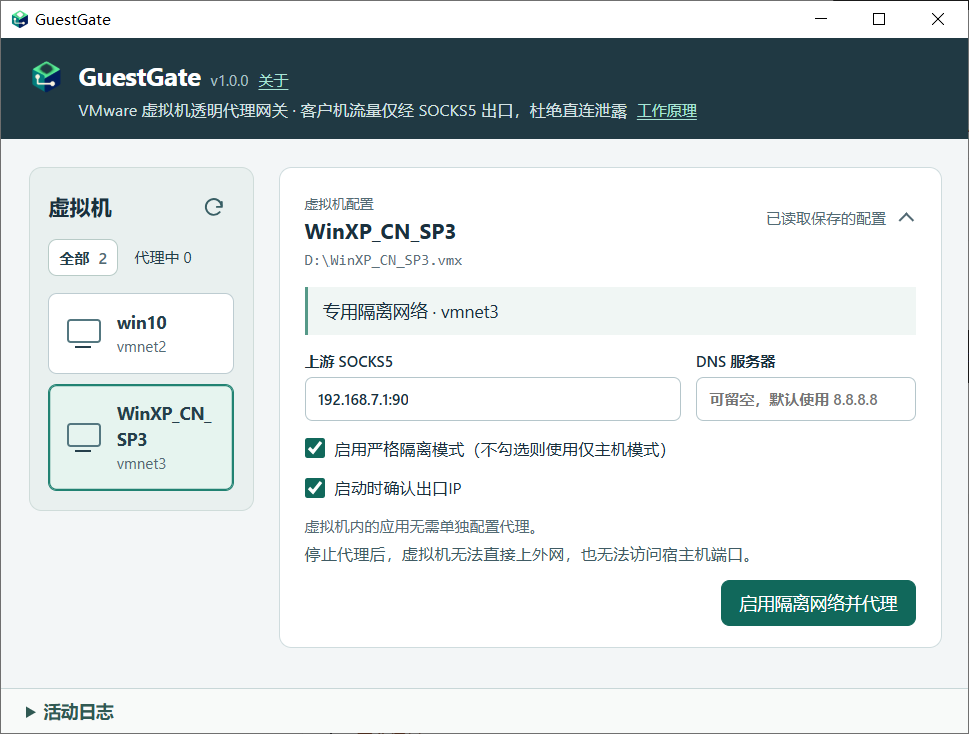

<h1 align="center">GuestGate</h1>

<p align="center">
  <strong>VMware 虚拟机透明代理网关</strong><br>
  整机流量经 SOCKS5 转发 · 每台虚拟机可单独配置 · 严格隔离模式防止直连泄露
</p>

<p align="center">
  欢迎扫码加入微信群讨论 <a href="./wechat-qr.svg"></a>
</p>

---

GuestGate 运行在 Windows 宿主机上。选一台正在运行的 VMware 虚拟机，填入 SOCKS5 地址，就能让虚拟机里的应用通过代理上网，无需逐个设置。你也可以给多台虚拟机指定不同的代理，分别启停。

严格隔离模式默认开启。GuestGate 会把虚拟机接入专用网络，阻断对宿主机端口的访问。代理断开或 GuestGate 停止后，虚拟机仍留在这个网络，不会自动切回 NAT 或桥接上网。



## 工作原理

**架构级防漏原理（零直出保障）**

1. **先切断外网：** 将虚拟机网卡设为仅主机模式（Host-Only）或隔离模式，从底层剥夺其直连公网的能力。
2. **单点搭桥：** GuestGate 直接监听该虚拟机网卡的底层数据包，并实现将其透明代理转发至上游代理。

**可靠性闭环：** GuestGate 是虚拟机通往外部的唯一桥梁。无论代理服务停止、程序意外退出还是上游节点故障，桥梁断开即刻彻底断网。

## 快速使用

准备一台装有 VMware Workstation 和 WebView2 的 Windows x64 宿主机。虚拟机只配置一个网络适配器，并启用 DHCP 自动获取 IP。

1. 启动虚拟机，在宿主机上以管理员身份运行 `GuestGate.exe`。
2. 在左侧选中虚拟机，填写上游 SOCKS5 地址，例如 `127.0.0.1:1080`。需要认证时可填 `socks5://用户名:密码@主机:端口`。
3. 点击 **启用隔离网络并代理**，核对出口 IP 和归属地后，点击 **确认并启用代理**。虚拟机接入后，会话显示 **已就绪**，并自动探测一次上游 SOCKS5 服务、TCP 和 UDP。之后可点击 **探测上游代理** 重新检测。

DNS 查询默认通过上游 SOCKS5 使用 TCP。只有当前会话的 UDP 探测收到 DNS 回复后，才会改用 UDP。UDP 查询失败时，GuestGate 会通过同一代理用 TCP 重试。

对于启用了 VMware 部分加密的虚拟机（例如带虚拟 TPM 的 Windows 11），在 VMware 解锁时勾选“记住密码”。之后用同一 Windows 账户启用代理，GuestGate 会自动使用这台虚拟机的已保存凭据完成网卡检查和切换。

点击 **停止代理** 可单独停止这台虚拟机的会话。要查看连接的目标地址、DNS 查询或失败原因，展开窗口底部的 **活动日志**。

## 用 FlClash 或 Clash Verge Rev 给每台虚拟机指定节点

在宿主机的 Clash 客户端加载订阅。GuestGate 的「上游 SOCKS5」旁有「为虚拟机指定 Clash 节点」入口，可直接复制脚本。发布包也附带同一份 [节点端口脚本](integrations/clash/node-ports.js)。

1. **应用到目标订阅。** FlClash 中右键目标配置，打开「扩展」并选择「脚本」。在「前往配置脚本」中导入文件或新建并粘贴脚本，返回选中它，点「立即应用」。Clash Verge Rev 中右键目标订阅，打开「扩展脚本」或「编辑脚本」，粘贴并保存。启用目标配置并使用规则模式。[FlClash 扩展脚本](https://github.com/chen08209/FlClash/blob/main/lib/views/profiles/extend/script.dart) · [Clash Verge Rev 扩展脚本](https://www.clashverge.dev/guide/extend.html)
2. **查看端口。** 在客户端的「端口对照」代理组查看映射。脚本按订阅中 `proxies` 的顺序从 `18901` 开始分配，仅在宿主机的 `127.0.0.1` 上监听。如果端口已被占用，可改脚本开头的 `startPort`。仅含 `proxy-providers` 的订阅不会生成端口。
3. **填写每台虚拟机的上游 SOCKS5。** 例如虚拟机 A 填 `127.0.0.1:18901`，虚拟机 B 填 `127.0.0.1:18902`。分别启用代理并核对出口 IP。订阅更新改变了节点顺序时，请重新查看「端口对照」。

脚本会把目标配置的分流规则替换为全部走「主出口」。如需继续使用原分流规则，请将脚本应用到单独的配置副本。

## 从源码构建

使用 `go.mod` 指定的 Go 版本，并将 GNU windres 加入 PATH。在项目目录运行以下 PowerShell 命令即可测试并生成 `GuestGate.exe`。

```powershell
go test ./...
.\scripts\build-windows.ps1
```

运行 `.\scripts\build-windows.ps1 -Package` 可在 `dist` 中生成带版本号的 Windows 发布包，内含节点端口脚本。

## 许可证

[MIT License](LICENSE)
